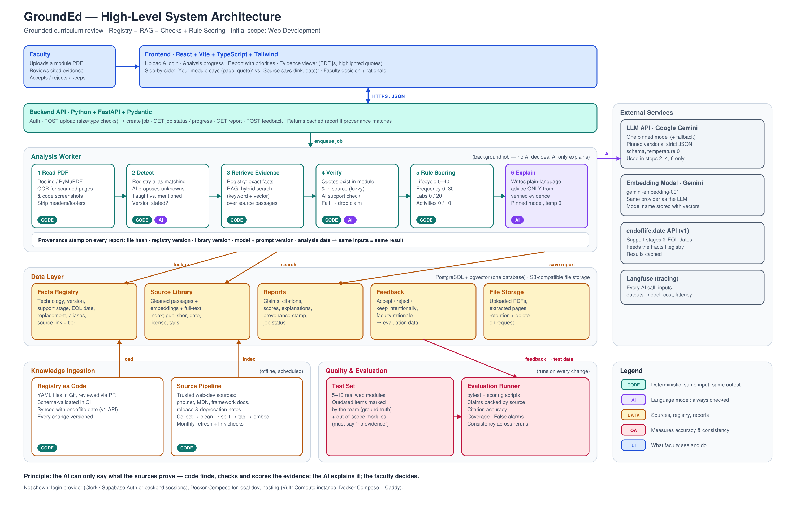
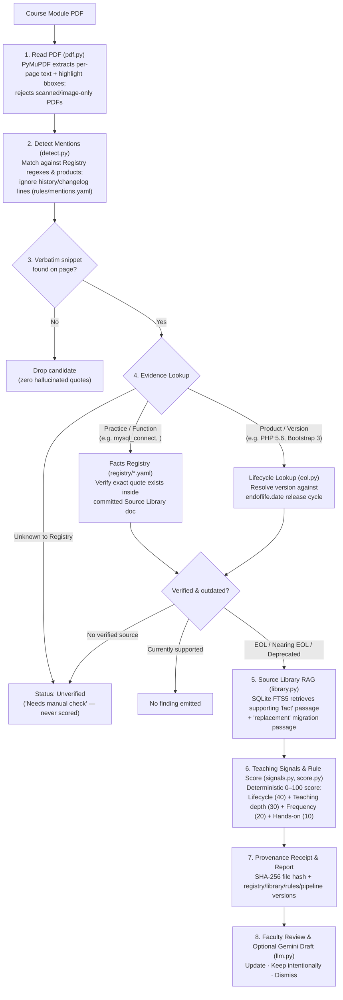
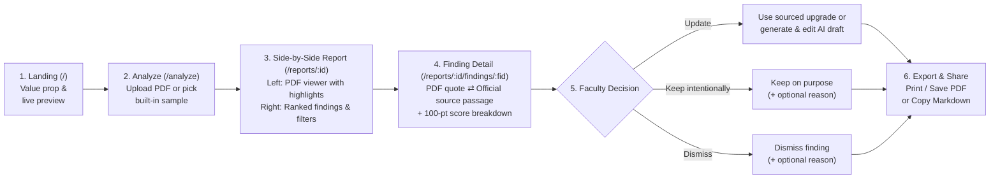

# GroundEd

**Source-backed AI for keeping university curricula current.**  
*Built for **HackGlobal 2026** — Track: **Grounded Knowledge & RAG***

An instructor or curriculum reviewer uploads a course module or syllabus (PDF). GroundEd detects every language, framework, database, function, and coding practice it teaches, verifies each against **[endoflife.date](https://endoflife.date)** and a **curated official documentation library** (`php.net`, MDN, MySQL Reference, OWASP), and backs every finding with **two verifiable citations**:
1. **Where it appears in the module** — exact page number, verbatim quote, and PDF highlight bounding box.
2. **Why it may warrant review** — the lifecycle record or verbatim official documentation passage behind it.

Anything without a verified source is marked **Unverified** instead of guessed. Every verified item gets a deterministic **100-point priority score** computed by fixed rules in code (never by an LLM), and **nothing counts as changed without the faculty member's explicit decision** (*Update*, *Keep intentionally*, or *Dismiss*).

---

## Table of Contents
1. [Use Case & Problem Statement](#1-use-case--problem-statement)
2. [System Design & Grounding Architecture](#2-system-design--grounding-architecture)
3. [Deterministic Priority Score (100 Points)](#3-deterministic-priority-score-100-points)
4. [User Flow & Screenshots](#4-user-flow--screenshots)
5. [Repository Layout](#5-repository-layout)
6. [Local Development & Evaluation](#6-local-development--evaluation)
7. [Deployment (Vultr Compute)](#7-deployment-vultr-compute)
8. [Full Documentation Index](#8-full-documentation-index)

---

## 1. Use Case & Problem Statement

> Full details: **[docs/use-cases.md](docs/use-cases.md)** · UX Research & Personas: **[docs/ux/personas.md](docs/ux/personas.md)**

### Why This Problem Matters
- **Silent curriculum drift:** Technology changes faster than syllabi and lab manuals are revised (Dobslaw et al., 2023). Frameworks reach end-of-life (`PHP 5.6`, `Python 2.7`, `AngularJS`, `Bootstrap 3`) and functions are removed (`mysql_connect()`, `<font>` tags) while still taught in inherited lab exercises.
- **Manual checking doesn't scale:** Faculty teaching 3–5 courses a term—or department chairs reviewing 20+ modules for accreditation—don't have time to cross-check every tool and version against release notes.
- **Generic AI chatbots can't be trusted by faculty:** Standard LLMs hallucinate EOL dates, give confident opinions without sources, and rewrite documents without preserving instructor intent. Faculty will only act on findings they can **verify in 30 seconds and defend to a curriculum committee**.

### Who GroundEd Serves
| User | Goal | How GroundEd Helps |
|---|---|---|
| **Course Instructor** *(Primary)* | Quickly spot outdated tools/practices before a new term while staying in control | Side-by-side PDF highlight + official source passage; optional AI rewrite suggestion; **Keep intentionally** option for legacy topics taught on purpose |
| **Curriculum Reviewer / Department Chair** | Audit multiple modules before accreditation with reproducible evidence | Deterministic 100-point priority score (same PDF = same score), cryptographic provenance stamp, and printable PDF / Markdown export |
| **Instructional Designer / Adjunct** | Update an inherited module they didn't author | Contextual migration passages from the RAG Source Library + editable AI draft grounded in the verified source |

---

## 2. System Design & Grounding Architecture

> Full details & sequence diagrams: **[docs/architecture.md](docs/architecture.md)** · Design rationale: **[docs/design-brief.md](docs/design-brief.md)**

**Core Principle:** *Code finds, checks, retrieves, and scores the evidence; the AI only drafts optional replacement wording from verified facts; the faculty member decides.*



### End-to-End Grounding & RAG Pipeline



### Non-Negotiable Grounding Guarantees
1. **No source, no claim:** Every scored finding has a verified verbatim PDF snippet (with page bounding box) **and** a verified record from `endoflife.date` or the curated Source Library (`backend/library/snapshot/`).
2. **Unverified ≠ Guessed:** If a mention lacks a verified source, it is flagged `unverified` (*"No trusted source found. GroundEd does not guess"*) and never scored.
3. **Deterministic scoring (Zero LLM variance):** Scores and priorities are computed strictly by rule-based Python code (`backend/app/score.py` & `backend/app/signals.py`). Running the same PDF twice always yields the exact same score.
4. **Strict separation of Sourced Facts vs. AI Suggestions:** Google Gemini (`backend/app/llm.py`) is invoked **only** when a user requests an optional rewrite draft on a verified finding, and its output is visually isolated in a dashed violet container labelled *"AI suggestion: not sourced. Review and edit before using."*
5. **Cryptographic provenance stamp:** Every report records the PDF's `file_sha256`, `pipeline_version`, `registry_version`, `library_version`, `rules_version`, and `analysis_date`.

---

## 3. Deterministic Priority Score (100 Points)

Implemented in `backend/app/score.py` with configurable weights in `backend/app/config.py` and teaching-signal rules in `backend/rules/teaching.yaml` ("Option C" — impact over age):

| Factor | Max Points | Deterministic Rule |
|---|---|---|
| **Lifecycle** | **40** | Ended or removed = `40` · Deprecated = `25` · Support ends within 12 months = `20` · Support ends within 24 months = `10` |
| **How it is taught** | **30** | Used in code students write (`code`) = `30` · Explained in prose (`explained`) = `15` · Only listed (`listed`) = `5` |
| **Frequency** | **20** | `4` points per page where the item appears (up to `20`) |
| **Hands-on** | **10** | `10` points if it appears on a lab, exercise, or activity page |

- **Priority thresholds:** **High** `≥ 80` · **Medium** `50–79` · **Low** `< 50`.
- **Supported** items produce no finding; **Unverified** items are not scored and are flagged *"needs manual check"*.

---

## 4. User Flow & Screenshots

> Full walkthrough & edge-case flows: **[docs/user-flow.md](docs/user-flow.md)** · Key UX flows: **[docs/ux/key-flows.md](docs/ux/key-flows.md)**



### Key Screens

1. **Landing Page (`/`)** — Introduces GroundEd's *evidence-first* approach with a before-and-after hero on the Horizon band and an interactive product preview.  
   

2. **Analyze a Module (`/analyze`)** — Drag-and-drop PDF upload (up to 10 MB, deleted immediately after extraction) plus instant one-click **Sample Modules** (including legacy PHP/MySQL web development modules and an out-of-scope *Ethics in Society (GED)* sample to demonstrate zero hallucinated findings).  
   

3. **Side-by-Side Report Workspace (`/reports/:id`)** — Displays the rendered PDF with interactive highlight bounding boxes on the left and prioritized findings grouped by status on the right, synced both ways.  
   

4. **Finding Detail, AI Suggestion & Faculty Decision (`/reports/:id/findings/:fid`)** — Places the module's verbatim quote beside the official documentation quote (`php.net`, `endoflife.date`, MDN) and SQLite FTS5 RAG passages, breaks down the 100-point score, offers an optional Gemini rewrite draft (dashed violet box), and records the instructor's decision (**Update**, **Keep intentionally**, or **Dismiss**).  
   

5. **Export & Methodology (`/methodology`)** — Exports a committee-ready report (Markdown or printable PDF with provenance receipt) and explains every rule behind detection, sources, and scoring.  
   

---

## 5. Repository Layout

```text
backend/                  FastAPI backend & deterministic grounding pipeline (Python 3.11+)
  app/
    main.py               FastAPI endpoints (/api/analyze, /api/samples, /api/analysis/{id}, /draft, /feedback)
    pipeline.py           End-to-end deterministic analysis pipeline & provenance stamping
    models.py             Pydantic API contract (mirrored in frontend/src/types.ts)
    pdf.py                PyMuPDF text extraction, scanned-PDF detection & snippet bounding boxes
    detect.py             Registry pattern matching & mention filtering
    registry.py           Loader for curated Facts Registry (backend/registry/*.yaml)
    eol.py                endoflife.date product resolution & release cycle lookup
    library.py            Curated Source Library + SQLite FTS5 passage retrieval (RAG)
    signals.py            Teaching depth (code / explained / listed) & hands-on lab detection
    score.py              Deterministic 100-point priority scoring ("Option C")
    llm.py                Isolated Google Gemini client (optional draft suggestions only)
    db.py, cache.py       SQLite storage for analyses, deterministic draft cache & feedback
    evaluate.py, cli.py   Evaluation harness & CLI tools
  library/                sources.yaml, coverage.yaml & committed documentation snapshot/
  registry/               Curated YAML facts & product version patterns (php.yaml, products.yaml)
  rules/                  mentions.yaml (changelog filter) & teaching.yaml (teaching depth regexes)
  data/                   Public sample syllabi (samples.yaml + PDFs) & runtime SQLite DB
  tests/                  Pytest suite covering pipeline, grounding, scoring, library & API limits

frontend/                 React 19 + Vite + TypeScript + Tailwind CSS v4 (DESIGN.md v2)
  src/
    pages/                Landing, Analyze, Report, FindingDetail, Reports, SignIn, Methodology, Feedback, NotFound
    components/           PdfViewer, ModuleView, FindingItem, ScoreBreakdown, SourcesList, ReportExport, DetailsDialog
    components/ui/        Design system primitives (AiSuggestion, DecisionControl, PriorityBadge, StatusBadge, QuoteBlock...)
    api.ts, types.ts      Typed API client & shared contract

deploy/                   Production deployment config (docker-compose.yml + Caddyfile for Vultr)
docs/                     Architecture, use cases, user flow, UX artifacts (docs/ux/), API contract & Vultr guide
DESIGN.md                 v2 Design System specification (Lapis & Clay palette, typography, accessibility, microcopy)
```

---

## 6. Local Development & Evaluation

### Backend (Python 3.11+)
```bash
cd backend
python -m venv .venv
# Windows: .venv\Scripts\activate    macOS/Linux: source .venv/bin/activate
pip install -r requirements.txt
cp .env.example .env        # Optional: add GEMINI_API_KEY for the "Generate AI draft" button
uvicorn app.main:app --reload --port 8000
# Interactive API docs: http://localhost:8000/docs
```

Run the backend test suite and evaluation runner:
```bash
cd backend
pytest
python -m app.cli eval
```

### Frontend (Node 20+)
```bash
cd frontend
npm install
npm run dev                 # Opens http://localhost:5173 (proxies /api to :8000)
```

---

## 7. Deployment (Vultr Compute)

On an Ubuntu instance with Docker and Docker Compose installed (full guide in **[docs/deploy-vultr.md](docs/deploy-vultr.md)**):

```bash
git clone https://github.com/educ-jkescritor/GroundEd.git && cd GroundEd
cp backend/.env.example backend/.env    # Fill in GEMINI_API_KEY and CORS_ORIGINS
SITE_ADDRESS=your.domain.or.ip.sslip.io docker compose -f deploy/docker-compose.yml up -d --build
```
Caddy serves the static React build, reverse-proxies `/api/*` to FastAPI inside the Docker network, and provisions automatic HTTPS certificates via Let's Encrypt.

---

## 8. Full Documentation Index

- **[docs/use-cases.md](docs/use-cases.md)** — Personas, problem statement, user stories, step-by-step main use case, and edge cases
- **[docs/architecture.md](docs/architecture.md)** — System overview, RAG & Registry pipeline, sequence diagram, and Vultr deployment architecture
- **[docs/user-flow.md](docs/user-flow.md)** — User flows, route map, and screen-by-screen visual walkthrough (`docs/screenshots/`)
- **[docs/design-brief.md](docs/design-brief.md)** — Pre-build design reasoning, lessons from the earlier ModSync prototype, and RAG track alignment
- **[DESIGN.md](DESIGN.md)** — Full v2 UI/UX Design System (Palette A · Lapis & Clay, typography, WCAG 2.2 AA contrast, microcopy)
- **[docs/ux/](docs/ux/)** — UX research artifacts: [personas.md](docs/ux/personas.md), [jobs-to-be-done.md](docs/ux/jobs-to-be-done.md), [information-architecture.md](docs/ux/information-architecture.md), [journey-map.md](docs/ux/journey-map.md), [key-flows.md](docs/ux/key-flows.md), [wireframes.md](docs/ux/wireframes.md)
- **[docs/api.md](docs/api.md)** — REST API contract (`backend/app/models.py` ⇄ `frontend/src/types.ts`)
- **[docs/deploy-vultr.md](docs/deploy-vultr.md)** — Step-by-step Vultr Compute production deployment guide
