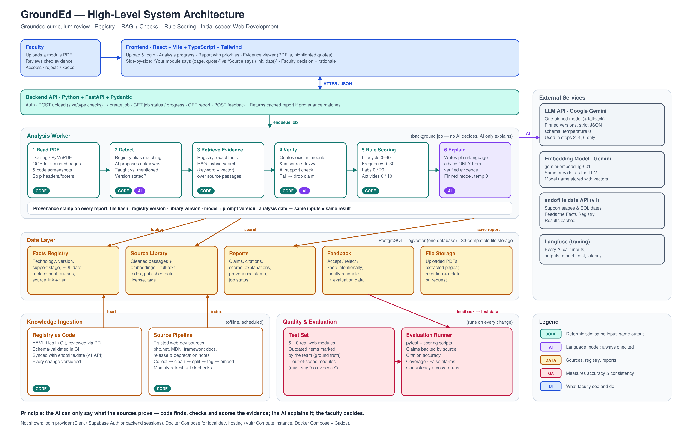
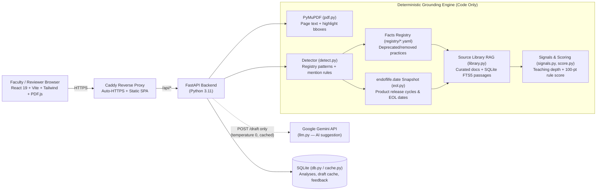
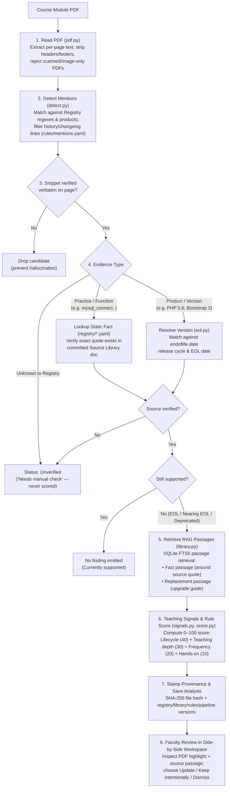
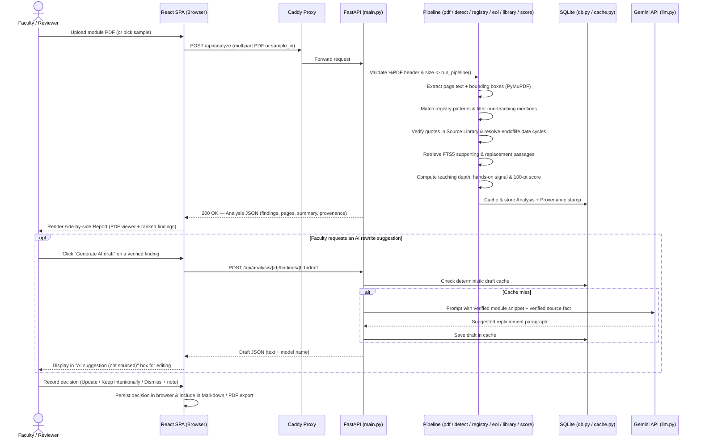
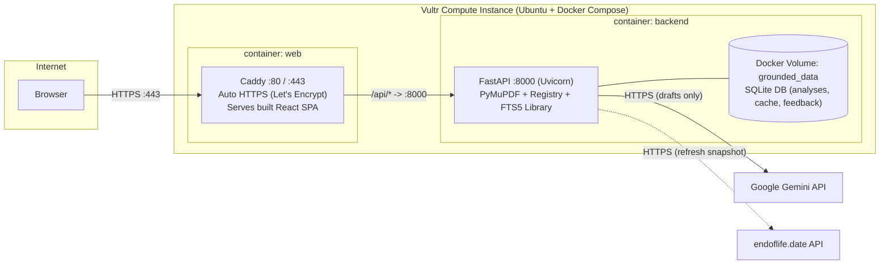

# System Architecture & Grounding Pipeline

GroundEd is built around a strict separation of responsibilities: **code extracts, verifies, retrieves, and scores evidence; the LLM only drafts optional replacement wording from verified evidence; the faculty member decides.**

## 1. System Overview

---

## 2. Analysis & Grounding Pipeline

Every uploaded module (or sample syllabus) passes through a deterministic, multi-stage verification pipeline (`backend/app/pipeline.py`):

---

## 3. Non-Negotiable Grounding Rules

1. **No source, no claim.** Every scored finding requires **two verified citations**:
   - **Where it appears in the module:** page number, verbatim snippet, and bounding box coordinates (`bbox`) on the PDF page.
   - **Why it may warrant review:** either a lifecycle record from `endoflife.date` or a verbatim quote verified by code inside a curated official document (`backend/library/snapshot/`, e.g., PHP Manual, MDN, OWASP, MySQL Reference).
2. **Unverified items are never guessed.** If a technology or version cannot be verified against the Facts Registry or `endoflife.date`, its status is set to `unverified` (*"No trusted source found. GroundEd does not guess"*), and it receives no priority score.
3. **The AI never supplies facts or scores.** All priority scores (`0–100`) are computed by deterministic rules in `backend/app/score.py` and `backend/app/signals.py` configured via `backend/rules/teaching.yaml`. Running the same PDF twice always produces the exact same findings and scores.
4. **Sourced facts and AI suggestions never look alike.** Gemini (`backend/app/llm.py`) is called **only** when a user explicitly clicks **Generate AI draft** on a verified finding, and receives only the verified module snippets and verified source facts. In the UI, AI drafts are isolated inside a dashed violet container labelled *"AI suggestion: not sourced. Review and edit before using."*
5. **Every report carries a cryptographic provenance receipt.** `Analysis.provenance` records the PDF's `file_sha256`, `pipeline_version`, `registry_version`, `library_version`, `rules_version`, `eol_data` timestamps, and `analysis_date`.

---

## 4. Sequence Diagram: End-to-End Module Review

---

## 5. Source Library (RAG) & Knowledge Architecture

To guarantee zero broken links and deterministic reproducibility during evaluation, GroundEd uses a **curated, snapshot-backed RAG library** (`backend/library/`):

| Component | Path | Responsibility |
|---|---|---|
| **Source Manifest** | `backend/library/sources.yaml` | Lists authoritative Tier-1/Tier-2 documentation URLs (PHP Group, MDN, MySQL, OWASP, etc.) and `endoflife.date` products. |
| **Committed Snapshot** | `backend/library/snapshot/` | Normalized text snapshots and `endoflife.date` JSON records committed to the repo so offline/hackathon runs never fail on external network hiccups. |
| **Facts Registry** | `backend/registry/*.yaml` | Maps regex patterns (e.g., `mysql_connect\s*\(`, `<font\b`, `password_hash`) to either an `endoflife.date` product cycle or a `StaticFact` with an exact quote in the snapshot library. |
| **FTS5 Passage Index** | `backend/app/library.py` | Indexes snapshot documents into an in-memory SQLite FTS5 table to retrieve contextual `fact` passages and `replacement` migration passages per finding. |
| **Teaching Rules** | `backend/rules/teaching.yaml` | Data-driven regex rules that classify how an item is taught (`code` vs. `explained` vs. `listed`) and whether a page is a lab/activity (`hands_on`). |

---

## 6. Deployment Architecture (Vultr Compute)

- Only ports `22` (SSH), `80`, and `443` are exposed on the host firewall (`ufw`).
- The FastAPI container (`:8000`) is reachable only inside the internal Docker network via Caddy.
- Uploaded PDFs are deleted immediately after text/coordinate extraction (`finally: path.unlink(missing_ok=True)` in `backend/app/main.py`).
