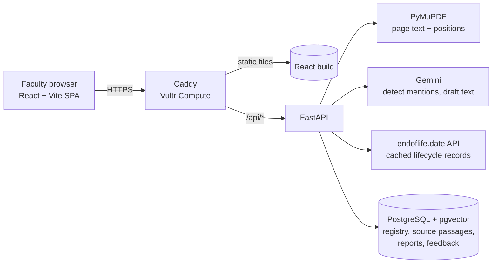
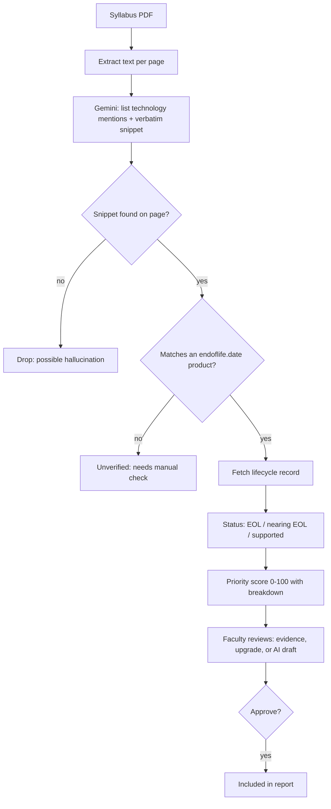
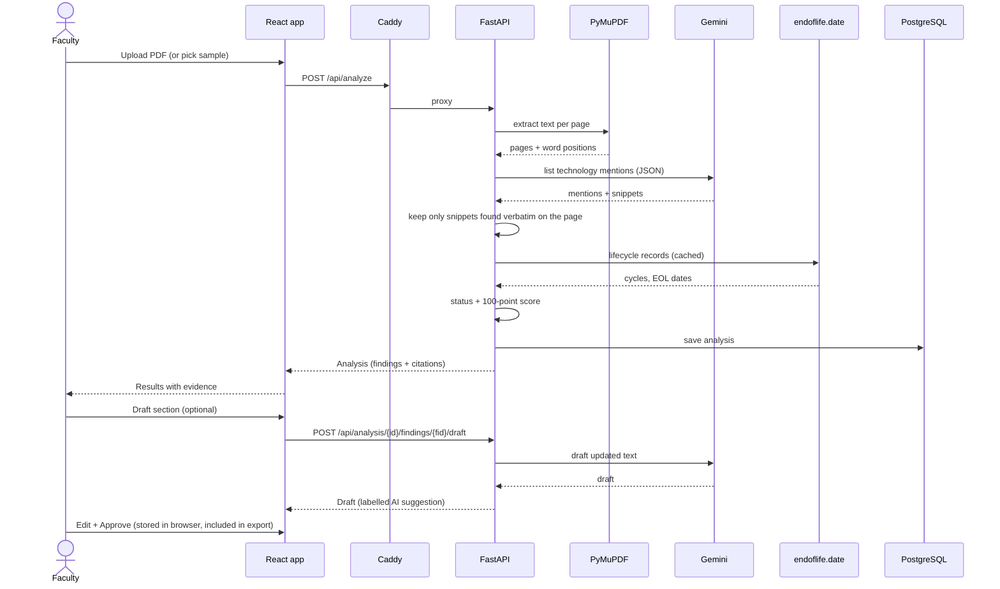
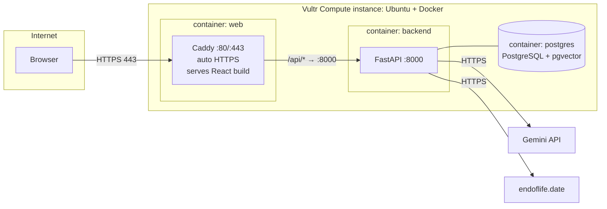

# Architecture

## Analysis pipeline

## Grounding rules
- Lifecycle facts come **only** from endoflife.date and always carry a link.
- Syllabus citations are verbatim text with a page number.
- LLM output is limited to detection (verified against page text) and drafts (labelled "AI suggestion, not sourced").
- Nothing is applied without faculty approval.

## Sequence: analyzing one syllabus

## Deployment on Vultr

Only ports 22 (SSH), 80 and 443 are open. The backend port 8000 is reachable only inside the Docker network.
