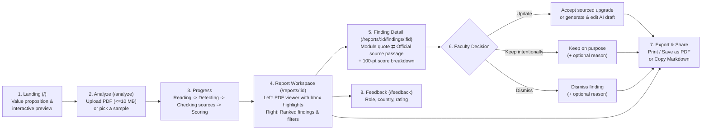
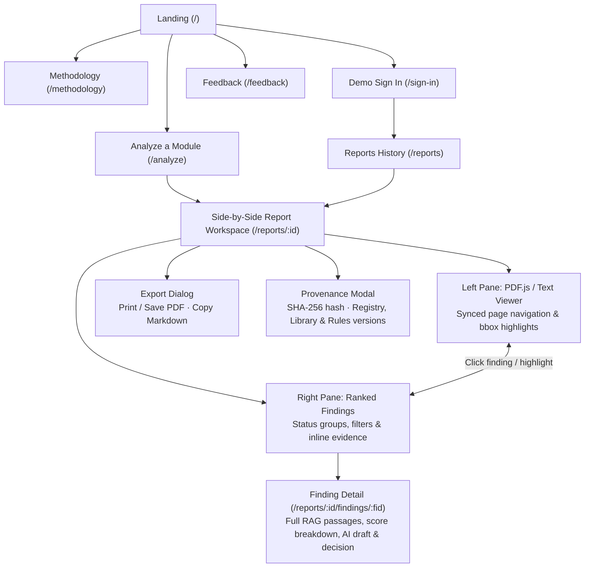
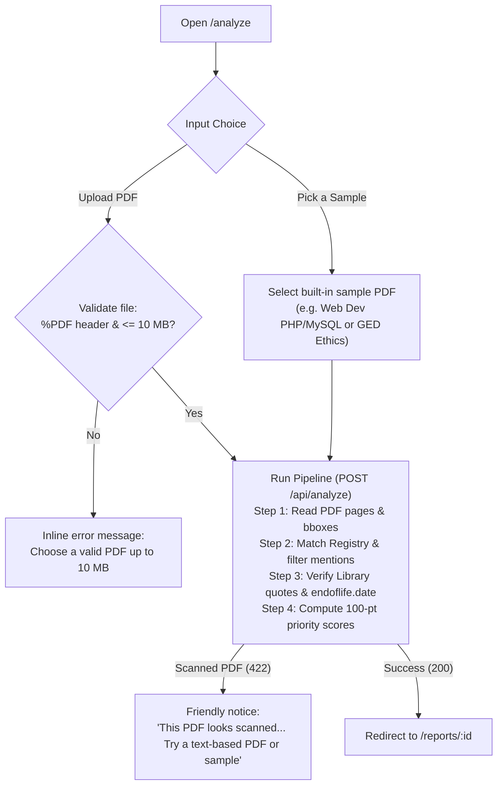
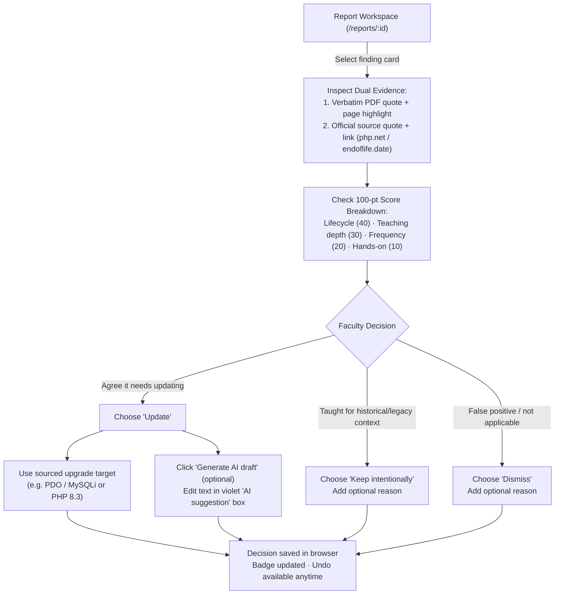

# User Flow & Visual Walkthrough

GroundEd uses a **side-by-side document and evidence review workflow** built for curriculum currency: upload a course module (or pick a sample) → view the module and ranked findings side by side → verify the dual citations (PDF quote + official source) → record a faculty decision (**Update**, **Keep intentionally**, or **Dismiss**) → export a shareable report.

---

## 1. End-to-End User Flow Overview

---

## 2. Application Site Map & Routes

Implemented in `frontend/src/App.tsx`:

---

## 3. Detailed Sub-Flows

### 3.1 Upload or Sample Selection → Analysis

### 3.2 Reviewing a Finding & Recording a Decision

---

## 4. Screen-by-Screen Visual Walkthrough

> **Screenshots Directory:** Place captured UI screenshots in `docs/screenshots/` using the filenames below so they render automatically in both this document and the root `README.md`.

### Step 1: Landing Page (`/`)
- **What the user sees:** The GroundEd value proposition (*"Source-backed AI for keeping university curricula current"*), a before-and-after hero on the signature Horizon band, an interactive mini-UI product preview, and a 3-step overview of how grounding works.
- **Primary action:** Click **Analyze a module** or **Try a sample**.

---

### Step 2: Analyze — Upload or Choose a Sample (`/analyze`)
- **What the user sees:**
  - Drag-and-drop PDF upload zone (validates `.pdf` up to 10 MB, with a privacy notice that uploads are deleted after extraction).
  - Pre-loaded **Sample Modules** for instant one-click testing by judges:
    - *Tech Modules (e.g., Web Programming with PHP & MySQL)* — demonstrates end-of-life products (`PHP 5.x`), removed functions (`mysql_connect()`), and deprecated HTML tags.
    - *Out-of-Scope Sample (Ethics in Society — GED)* — demonstrates that GroundEd never invents findings on non-technology courses.
  - Honest step-by-step progress indicator while the pipeline runs (*Reading module → Detecting technologies → Checking trusted sources → Calculating priority*).

---

### Step 3: Side-by-Side Report Workspace (`/reports/:id`)
- **What the user sees:**
  - **Report Header:** Module filename, page count, summary counts (*End-of-life*, *Nearing end-of-life*, *Unverified*), **Provenance Details** button (SHA-256 hash, registry/library/rules versions), and **Export** menu.
  - **Left Pane (Module Viewer):** Renders the actual PDF pages via PDF.js with interactive bounding-box highlights over every detected snippet (plus a toggle for extracted text view).
  - **Right Pane (Ranked Findings):** Findings sorted highest-priority first (`High ≥ 80`, `Medium ≥ 50`, `Low < 50`), showing item kind (*Language*, *Framework*, *Practice*, *Tool*), status badge, teaching context (*"Used in code students write · on a lab or exercise page"*), and dual citations.
  - **Two-way sync:** Clicking a finding jumps the PDF viewer to the exact page and highlights the quote.

---

### Step 4: Finding Detail, AI Draft & Faculty Decision (`/reports/:id/findings/:fid`)
- **What the user sees:**
  - **Side-by-side Evidence:**
    - *In your module:* Exact quote and page number(s).
    - *Trusted source:* Publisher (`php.net`, `endoflife.date`, MDN), verbatim proving quote, EOL date, and external verification link, plus retrieved context passages from the SQLite FTS5 Source Library.
  - **100-Point Priority Breakdown:** Visual bars showing exact points earned across *Lifecycle (max 40)*, *How it is taught (max 30)*, *Frequency (max 20)*, and *Hands-on (max 10)*.
  - **Optional AI Suggestion:** Clicking **Generate AI draft** calls Gemini with only the verified snippet and verified fact. The output appears in a distinct dashed violet box labelled *"AI suggestion: not sourced. Review and edit before using."*
  - **Decision Controls:** Faculty record **Update**, **Keep intentionally**, or **Dismiss** with an optional note. When all findings are decided, the Sprout completion banner appears (*"All findings reviewed. Your module is ready for next term"*).

---

### Step 5: Export, Provenance & Methodology (`/methodology`)
- **What the user sees:**
  - **Export Dialog:** Copy a structured Markdown summary or trigger a print/PDF report containing every finding, its verified sources, the instructor's decisions, and the cryptographic provenance footer.
  - **Methodology Page (`/methodology`):** Plain-language documentation inside the app explaining how GroundEd detects mentions, why AI never scores or supplies facts, and how the 100-point rubric works.

---

## 5. Error & Edge-Case Flows

| Situation | User-Facing Behavior | Recovery Action |
|---|---|---|
| **Non-PDF or > 10 MB file** | Inline error: *"Please choose a PDF up to 10 MB."* | Select a valid PDF file |
| **Scanned / image-only PDF** | HTTP `422`: *"This PDF looks scanned, so we can't read its text yet."* | Upload a text-based PDF or click a sample module |
| **Non-tech / GED course module** | Calm empty state: *"This module looks like it's outside technology courses, so there's nothing to report yet."* | Analyze another module or view `/methodology` |
| **Unrecognized tool / version** | Status badge **Unverified**: *"No trusted source found. GroundEd does not guess. Please check this one yourself."* | Link provided for manual verification; excluded from score |
| **AI draft endpoint busy (`429`/`503`)** | Sourced report and scores remain 100% intact; draft box shows retry message | Retry draft generation or use the sourced upgrade target directly |
