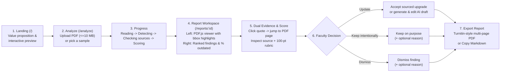
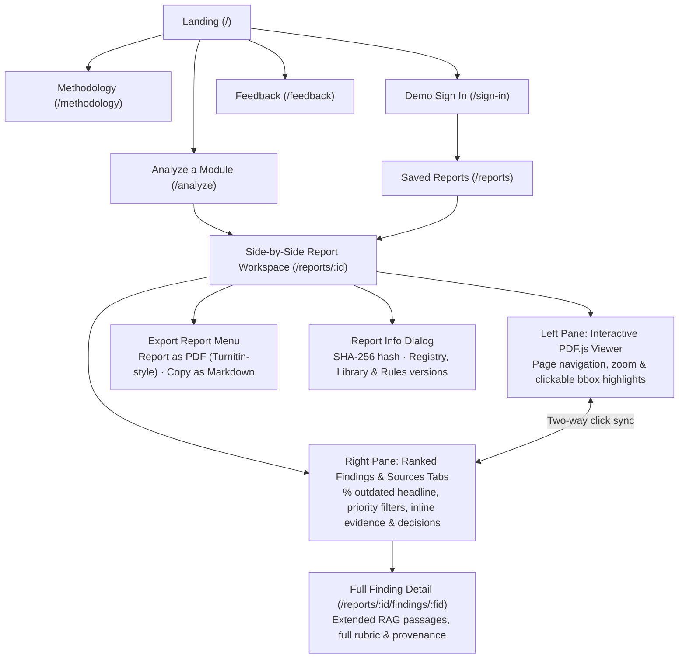
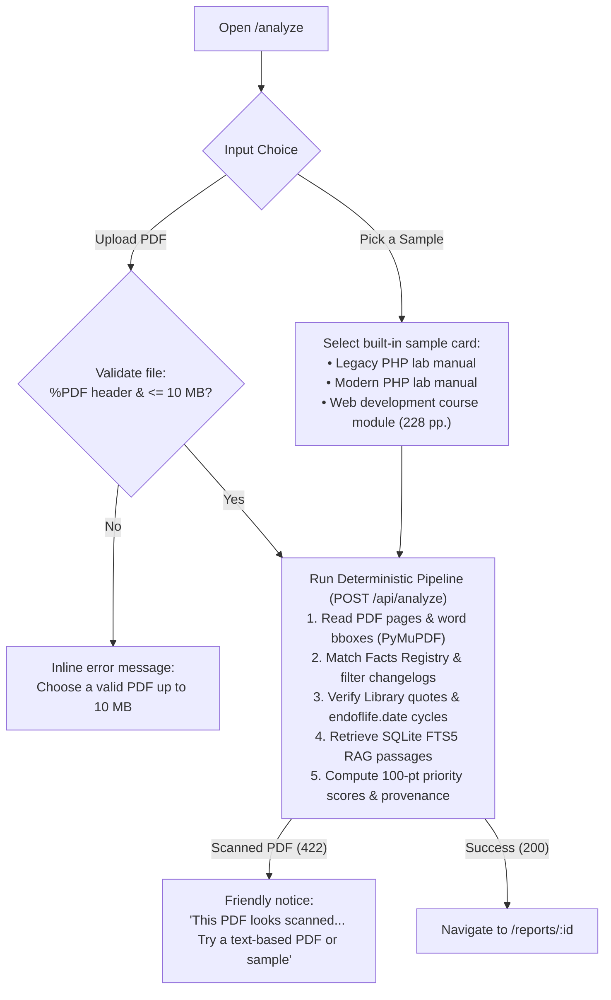
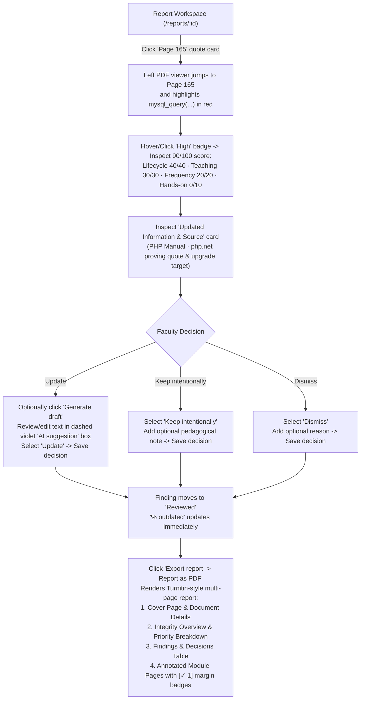

# User Flow, Information Architecture & Visual Walkthrough

GroundEd uses a **side-by-side document and evidence review workflow** built for curriculum currency: upload a course module PDF (or pick a built-in sample) → inspect interactive highlights on the rendered PDF pages alongside ranked findings and official sources → optionally generate an editable AI rewrite draft → record a faculty decision (**Update**, **Keep intentionally**, or **Dismiss**) → export a Turnitin-style multi-page PDF or Markdown report.

---

## 1. End-to-End User Flow Overview

---

## 2. Information Architecture & Site Map

### 2.1 Application Route Map (`frontend/src/App.tsx`)

### 2.2 Pages & Primary Responsibilities

| Route | Page | Primary Purpose | Key Elements |
|---|---|---|---|
| `/` | **Landing** | Explain value proposition and earn trust in 10 seconds | Horizon before/after hero, interactive product preview, 3-step grounding overview, trust guarantees |
| `/analyze` | **Analyze a Module** | Accept a module PDF or launch a built-in sample | Drag-and-drop PDF dropzone (`≤ 10 MB`), privacy note, 3 sample module cards, 4-step pipeline progress view |
| `/reports/:id` | **Report Workspace** | Side-by-side PDF and evidence review | Top bar (`Report info`, `New analysis`, `Export report`), left PDF.js canvas with colored bounding-box overlays, right findings panel (`To review` / `Reviewed`, `% outdated`, priority filter pills, `Findings` & `Sources` tabs) |
| `/reports/:id/findings/:fid` | **Finding Detail** | Deep-dive view for a single finding | Side-by-side module quotes vs. Source Library RAG passages (`fact` + `replacement`), full 100-point breakdown, AI draft, decision controls |
| `/methodology` | **Methodology** | Transparent documentation of rules & sources | Source tiers (`endoflife.date`, official docs), detection & changelog filtering rules, 100-point Option C rubric |
| `/reports` & `/sign-in` | **History & Demo Sign-In** | One-click browser demo profile & saved reports | Instant passwordless demo login (`Log in`) so judges can test report history without account creation friction |
| `/feedback` | **Feedback** | Collect educator & reviewer feedback | Role, country, institution, 1–5 trust rating, `would_use`, and optional quotable comments |

### 2.3 Report Content Model & Finding Card Anatomy

Every finding card in the Report Workspace presents sourced facts and faculty controls in a scannable hierarchy:

| Element | Shown in Card | On Click / Hover | Source of Truth |
|---|---|---|---|
| **Header & Kind** | Technology / practice name (`PHP mysql extension (mysql_* functions)`), version/cycle, page list | Expands or collapses card | `Finding.technology`, `Finding.version`, `Finding.citations` |
| **Priority Pill** | `High` (`≥ 80`), `Medium` (`50–79`), or `Low` (`< 50`) badge | Opens the **100-point score breakdown popover** (`Lifecycle 0–40`, `How it is taught 0–30`, `Frequency 0–20`, `Hands-on 0–10`) | `Finding.score` (`backend/app/score.py`) |
| **Outdated in Your Module** | Verbatim snippet quotes extracted from the PDF with `Page N` pills | Clicking any quote card scrolls the left PDF viewer to `Page N` and pulses the red bounding-box highlight on the page | `Finding.citations[].snippet`, `page`, `bbox` (`backend/app/pdf.py`) |
| **Updated Information & Source** | Sourced replacement (`Use mysqli or PDO (with prepared statements) instead`), lifecycle status & EOL date, publisher badge (`php.net ↗`), and verbatim proving quote | Clicking the card opens the official external documentation URL (`https://www.php.net/...` or `https://endoflife.date/...`) in a new tab | `Finding.lifecycle`, `Finding.upgrade`, `Finding.passages` (`eol.py`, `library.py`) |
| **Draft Updated Wording** | `Generate draft` button | Calls `POST /api/analysis/{id}/findings/{fid}/draft` and renders an editable textarea inside a dashed violet container labelled **`AI suggestion · Not a sourced fact`** | `backend/app/llm.py` (Gemini, isolated from facts/scores) |
| **Your Decision** | Radio pills: **Update** · **Keep intentionally** · **Dismiss** (+ optional reason note) | Moves the finding into the **Reviewed** group, recalculates the `% outdated` metric, and includes the decision in PDF/Markdown exports | Browser storage (`decisions.ts`) |

---

## 3. Detailed Sub-Flows

### 3.1 Upload or Sample Selection → Deterministic Pipeline (`POST /api/analyze`)

### 3.2 Reviewing a Finding, Recording a Decision & Exporting the PDF Report

---

## 4. Screen-by-Screen Visual Walkthrough

### Step 1: Analyze a Module — Upload PDF or Pick a Built-In Sample (`/analyze`)
- **What the user sees:**
  - Drag-and-drop PDF upload zone (validates `.pdf` up to 10 MB, with a clear privacy commitment that uploaded files are deleted immediately after text extraction).
  - Three pre-loaded **Sample Modules** (`backend/data/samples/samples.yaml`) for instant one-click testing:
    1. **Legacy PHP lab manual (sample)** — PHP + MySQL lab using `mysql_*` functions, ASP-style tags, Windows 7, and Internet Explorer.
    2. **Modern PHP lab manual (sample)** — The same lab rewritten for PHP 8 with PDO and current tools (produces 0 findings).
    3. **Web development course module (sample)** — A full 228-page PHP and MySQL course module (modules 1–7) written by the GroundEd team.

---

### Step 2: Side-by-Side Report Workspace & Interactive PDF Highlights (`/reports/:id`)
- **What the user sees:**
  - **Report Header:** Module title (`Web development course module`), `Report info` provenance button, `+ New analysis`, and `Export report` menu.
  - **Left Pane (Interactive PDF Viewer):** Renders the actual 228-page course module via PDF.js with page navigation, zoom controls, a mini-map scrollbar marker showing every flagged page, and interactive bounding-box highlights right on the slide/page (`Page 165 of 228 · Using Group Functions`).
  - **Right Pane (Ranked Findings):** Displays the headline count (`6 findings to be reviewed`), the overall `% outdated` metric (`62% OUTDATED`), priority filter pills (`All 6`, `High 1`, `Medium 2`, `Low 3`), and expandable finding cards sorted highest-priority first.

---

### Step 3: Dual Citations & Deterministic 100-Point Priority Score Breakdown
- **What the user sees:**
  - **Two verifiable citations per finding:**
    - **Outdated in your module:** Exact verbatim quotes (`"$query = mysql_query(\"SELECT SUM(tuition) FROM tblstudent\");"`) with clickable `Page 165`, `Page 166`, `Page 167` buttons that scroll the PDF viewer directly to the highlighted line.
    - **Updated information & source:** The verified replacement (`Use mysqli or PDO (with prepared statements) instead`), lifecycle date (`No longer supported since 2015 (3 Dec 2015)`), official publisher link (`php.net ↗`), and verbatim documentation quote.
  - **100-Point Score Breakdown Popover:** Clicking or hovering the `High` priority badge reveals the exact deterministic rubric calculation (`High priority: 90 of 100` — `Lifecycle 40/40`, `How it is taught 30/30`, `Frequency 20/20`, `Hands-on 0/10`).

---

### Step 4: Optional AI Suggestion (Badged & Editable) & Faculty Decision
- **What the user sees:**
  - **Visual separation of AI suggestions from sourced facts:** When the instructor clicks **Generate draft**, Gemini drafts replacement wording using only the verified module snippet and the verified `php.net` documentation passage. The result is isolated inside a dashed violet box explicitly badged **`AI suggestion · Not a sourced fact`** with an editable textarea and `Regenerate` control.
  - **Faculty-in-the-loop Decision Controls:** The instructor records **Update**, **Keep intentionally**, or **Dismiss**. Saving a decision moves the card to the **Reviewed** section and updates the `% outdated` summary (`62% → 47%`).

---

### Step 5: Turnitin-Style Multi-Page PDF Report Export
- **What the user sees:**
  - Clicking **Export report → Report as PDF** renders a multi-page **Faculty Curriculum Review** PDF report (`frontend/src/components/ReportExport.tsx`) modelled after Turnitin's similarity report layout:
    1. **Cover Page:** Submission ID (`grd:oid:::...`), timestamps, filename, file size, page/word/character counts, and cryptographic provenance metadata.
    2. **Integrity Overview & Findings Table:** Summary metrics (`% Outdated`, `Findings to Review`, `Decisions Recorded`) followed by side-by-side cards showing **In the Module**, **Official Source**, **Recommended Update**, and **Faculty Decision** (including any faculty-approved replacement wording).
    3. **Annotated Module Pages:** High-resolution renders of every flagged PDF page with color-coded bounding-box highlights, numbered margin badges (`[✓ 1]`), and an **On this page** footer legend.

---

### Step 6: Zero False Alarms on Current Curricula (`Modern PHP lab manual`)
- **What the user sees:**
  - Running the **Modern PHP lab manual (sample)**—which teaches `PHP 8` and `PDO` prepared statements—produces **`Nothing to review`** and **`0% OUTDATED`**, proving that GroundEd recognizes supported technologies and never invents findings.

---

## 5. Error & Edge-Case Flows

| Situation | User-Facing Behavior | Recovery Action |
|---|---|---|
| **Non-PDF or `> 10 MB` file** | Inline error message: *"Please choose a PDF up to 10 MB."* | Choose a valid PDF file or click a sample module |
| **Scanned / image-only PDF** | HTTP `422`: *"This PDF looks scanned (image-only), so we can't read its text yet."* | Upload a PDF with selectable text or try a sample module |
| **Modern / up-to-date module** | `Nothing to review · 0% OUTDATED`: *"We didn't find tools or practices that may be outdated."* | Export clean verification report or analyze another module |
| **Unrecognized tool / version** | Status badge **Unverified**: *"No trusted source found. GroundEd does not guess. Please check this one yourself."* | External link provided for manual check; excluded from priority score |
| **AI draft endpoint busy (`429`/`503`)** | Sourced report, citations, and scores remain `100%` intact; draft box displays a non-blocking retry notice | Click `Regenerate` or use the sourced upgrade target directly |
