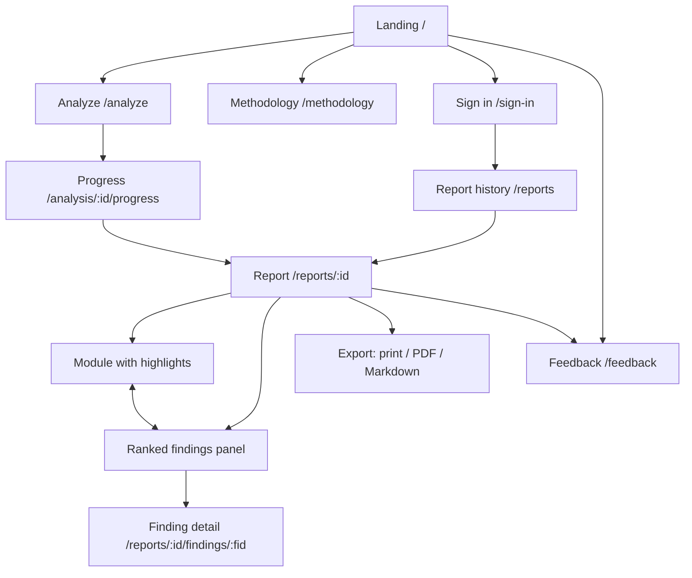

# Information architecture

> **Status: draft for review (Phase 2, 14 Nov 2026).** Rows marked **Proposal** need your OK; rows marked
> **Backend** need your teammate's confirmation, because the frontend follows the backend's format.

## Phase 2 decisions
| Topic | Decision |
|---|---|
| Name for the uploaded file | **Module**, everywhere in the UI. The Landing page says "syllabus, module or lesson guide" once, so everyone recognises their document. |
| Results layout | **Side by side** (the originality-checker pattern): the module with highlights on the left, the ranked findings panel on the right, synced both ways. A finding expands in the panel; **Open full detail** goes to the finding detail page. Below 1024 px: list only. *(Changed from the earlier hybrid tabs.)* |
| Decisions on a finding | **Update** (agree; accept the upgrade or approve a draft) · **Keep intentionally** (taught on purpose) · **Dismiss** (not outdated / incorrect). Each has an optional reason. A finding with no decision is **To review**. |
| Accounts | **Sign-in exists, but is never required to try GroundEd.** For the hackathon, a **browser-only demo account** gives one-click access to saved reports (see "Accounts" below). |
| Extra screens | **Methodology**, **Report history**, **Sign in (demo account)**. |
| Course scope | Technology-related courses only; GED modules get "not covered yet". |

## Site map


**Proposal: URL changes from today's app.** `/results/:id` becomes `/reports/:id` (matches "report" wording),
and `/reports` lists history. Old links redirect.

## Navigation
**Header (all pages):** Logo (home) · **Analyze a module** (primary button) · How it works (Methodology) ·
Reports (history) · Feedback · **Sign in** or account menu (demo name, Sign out).

**Report page tabs:** Findings · Document. Plus actions: Export ▾ (Print/PDF, Copy Markdown) · Give feedback.

**Footer:** Methodology · Sources (endoflife.date and others) · GitHub · Feedback · "Advisory tool: you decide."

## Pages
| Page | Purpose | Primary action | Content priority (top → bottom) |
|---|---|---|---|
| Landing | Explain value and earn trust in 10 seconds | Analyze a module | Promise → example finding → how it works → trust principles → scope (tech courses) → CTA |
| Analyze | Get a module in | Upload PDF | Upload zone → scope note (tech courses, PDF with text) → samples → privacy note |
| Progress | Reassure while it works | (wait) / Cancel | Steps with status → time estimate → what's happening in plain words |
| Report | See what matters first, in context | Open the top finding | Header: headline + priority counts · Left: module pages with highlights · Right: filters → ranked findings (expandable) |
| Finding detail | Judge one finding | Record a decision | Module quote + page ⇄ source passage + link → why (score) → help options → decision |
| Methodology | Explain how results are made | Back to analyze | Sources and tiers → checks → scoring rules → limits → "as of" dates |
| Report history | Return to past work | Open a report | List: module name, date, counts, decisions done |
| Sign in | Access saved reports | Continue with demo account | Demo button → note that it's a hackathon demo |
| Feedback | Collect evidence for Reach | Send feedback | Role, country, rating, would use, comments, consent |

## Content model (what a report contains)
| Element | Shown by default | On demand | Source of truth |
|---|---|---|---|
| **Report header** | Module name, pages, date analysed, headline summary | Provenance stamp (file hash, registry/library version, model + prompt version) | Backend |
| **Finding: name** | Technology/practice as written + version | Name variants found | Backend |
| **Kind** | Small label: *Tool/Framework*, *Language*, *Practice*, *Topic* | — | **Backend** (confirm field) |
| **Claim type** | Status badge: End-of-life · Nearing end-of-life · Supported · **Less used in industry** · Unverified | — | **Backend**: "unsupported" vs "less popular" must stay separate |
| **Use in module** | "Taught in labs" / "In an activity" / "Mentioned" | — | **Backend** (taught vs mentioned) |
| **Priority** | High / Medium / Low + score | Score breakdown (lifecycle, frequency, labs, activities) | Backend (`score.priority`) |
| **Module evidence** | Quote + page | Highlight in the module column, all occurrences | Backend |
| **Source evidence** | Source name, tier label, date, link | Passage snapshot, publisher, collected date | **Backend** (source fields) |
| **Confidence** | Only when low: "Limited evidence" note | Percentage + what's missing | **Backend** |
| **Suggestion** | Sourced upgrade (if any) | AI draft (always labelled) | Backend |
| **Decision** | Badge: To review / Updated / Kept / Dismissed | Reason text, approved wording | Frontend now; backend later (history) |

**Proposal: evidence on demand.** Showing everything at once overwhelms; showing too little loses trust. Default =
quote + page + source name/tier/date/link + priority. Everything else is one click away.

## Accounts (hackathon)
- **Guests can do everything** (analyze, review, export). Reports are kept in that browser.
- **Sign in** adds report history that stays with the account.
- **Hackathon demo account:** a "Continue with demo account" button signs in instantly as a shared demo user
  (for example "Demo Faculty") that already has 2–3 sample reports in its history. **No password typing**,
  so judges and testers can't get stuck. Real sign-up is out of scope and listed as future work.
- **Decided: browser-only.** The demo account exists only in the browser (no backend accounts). "Signing in"
  sets a demo profile in browser storage; history lists report IDs saved in that browser. It's for demo
  purposes only and is labelled that way on the Sign in page.

## Glossary (use these words, consistently)
| Use | Avoid | Meaning |
|---|---|---|
| **Module** | syllabus, file, document (in UI copy) | The uploaded course material |
| **Report** | results, analysis | Everything GroundEd found for one module |
| **Finding** | claim, issue, error | One item that may warrant review |
| **May warrant review** | outdated!, wrong, must fix | Default advisory phrase |
| **End-of-life** | dead, obsolete | No longer supported by its maintainers (sourced) |
| **Less used in industry** | unpopular, bad | Still supported, but declining use (trend source) |
| **Unverified** | unknown, error | No trusted source found; GroundEd doesn't guess |
| **Source** | reference, link | A trusted document backing a finding |
| **Source tier** | quality | How strong the source is: 1 support data · 2 official docs · 3 curriculum standards · 4 industry trends |
| **Update / Keep intentionally / Dismiss** | accept / reject | The user's decision on a finding |
| **AI suggestion** | AI answer, AI fix | Text written by AI, not a sourced fact |
| **Not covered yet** | unsupported, error | The module is outside tech courses (e.g. GED) |

## Finding fields explained (reference for the API)
Example used throughout: the module says *"Lab 3: Connect to the database using `mysql_connect()`"* on page 4.

| Field | Meaning | Values / example | Shown in the UI |
|---|---|---|---|
| **Item kind** | What sort of thing was found | Tool/Framework · Language · Practice · Topic (`mysql_connect()` = Practice) | Small grey label before the name; filter in the findings panel |
| **Claim type** | Why it may warrant review; **unsupported and less popular are never mixed** | Unsupported (removed/unmaintained, official source) · Less popular (still supported, declining; trend source) | Status badge (icon + label): End-of-life · Nearing end-of-life · Supported · **Less used in industry** (informational, never red) · Unverified |
| **Taught vs mentioned** | How the module uses it | Taught in labs · In an activity · Mentioned | Summary line ("Taught in labs · pages 4, 6"); feeds Labs/Activities in the score |
| **Source tier** | Strength of the source | 1 Support data · 2 Official documentation · 3 Curriculum standards · 4 Industry trends | Word label on the source ("Official documentation") + tooltip; tier 4 alone never makes something end-of-life |
| **Publisher** | Who wrote the source | PHP Group (php.net), Mozilla (MDN), endoflife.date | First line of the source card, with link |
| **Dates** | When the source said it; when we checked it | Published 3 Dec 2015 · Checked 10 Nov 2026 | Under the publisher |
| **Passage text** | Exact words from the source backing the finding | "The original MySQL extension was removed in PHP 7.0.0." | Finding detail, side by side with the module quote, serif quote style |
| **Confidence** | Share of the score backed by verified evidence, **computed by code** | e.g. 0.6 when lab usage couldn't be confirmed | Hidden when high; when low, a note ("Limited evidence: check page 6"); % in score details |
| **Provenance stamp** | The report's receipt: file hash, registry/library versions, model + prompt version, date | Same inputs → same result | Report header "As of 14 Nov 2026" + Details link; printed in the export footer |

```
[Practice]  mysql_connect()          [End-of-life]  [High priority] 86/100
Taught in labs · pages 4, 6 · may warrant review
───────────────────────────────────────────────────────────────────────
IN YOUR MODULE (p. 4)            │ SOURCE · Official documentation
"Lab 3: Connect to the database  │ PHP Group · php.net
 using mysql_connect()"          │ "The original MySQL extension was removed in PHP 7.0.0."
                                 │ Published 3 Dec 2015 · Checked 10 Nov 2026 ↗
───────────────────────────────────────────────────────────────────────
Why 86/100?  Lifecycle 40 · Frequency 12 · Labs 20 · Activities 10 (+ details)
Your decision:  [Update]  [Keep intentionally]  [Dismiss]
```
