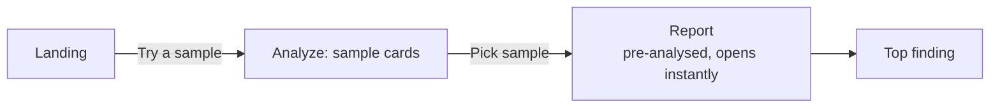
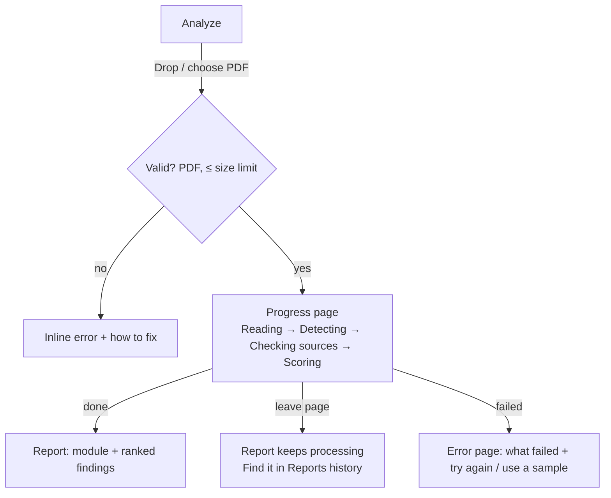
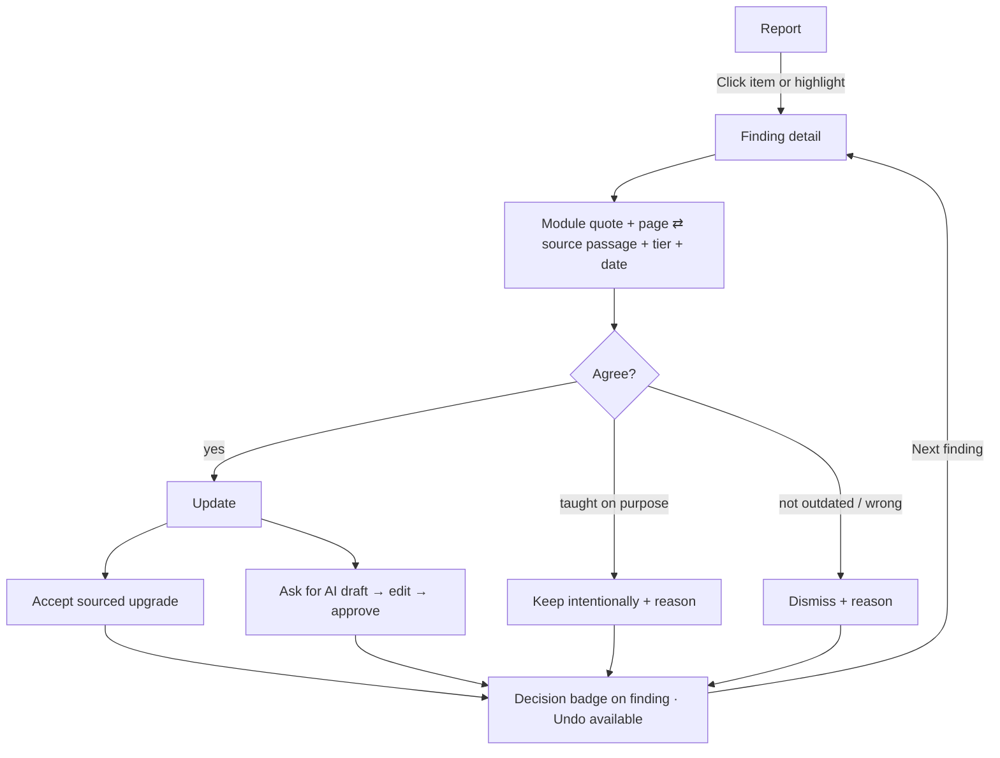
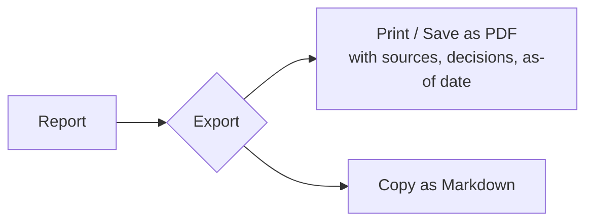
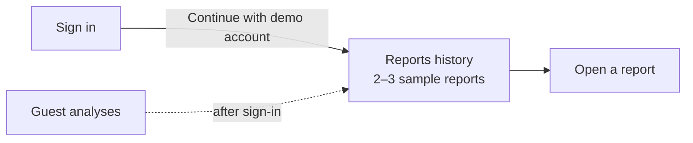
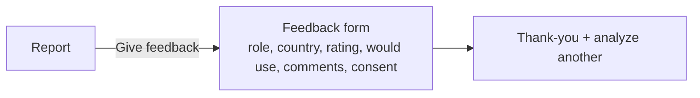

# Key flows

> **Status: draft for review (Phase 2).** Each flow lists its success criterion (from
> [jobs-to-be-done.md](jobs-to-be-done.md)), to be measured in the Phase 7 usability check.

## 1. First visit → try a sample
**Success:** first finding visible in under 1 minute.

## 2. Upload → progress → report
**Success:** user never wonders whether it's stuck.

## 3. Review a finding → decide
**Success:** explains why it's flagged in under 30 s; records a decision first try.

## 4. Export and share
**Success:** shareable report in under 1 minute.

## 5. Sign in with the demo account → history

## 6. Feedback

## 7. Error and edge paths (what the user sees)
| Situation | Message (draft) | Way forward |
|---|---|---|
| Not a PDF / too large | "Please choose a PDF up to 10 MB." | Choose another file |
| Scanned PDF (no text) | "This PDF looks scanned, so we can't read its text yet." | Upload a text-based PDF · Try a sample |
| **GED / non-tech module** | "This module looks like it's outside technology courses. GroundEd covers IT and computing courses for now, so there's nothing to report." | Analyze another module · Learn what's covered (Methodology) |
| No findings in a tech module | "We didn't find technologies or practices that may warrant review." + what was checked | Export the clean report |
| AI service busy | "Our analysis service is busy right now. Your module wasn't lost: try again in a minute, or explore a sample." | Retry · Sample |
| A source link is dead | Show the stored passage snapshot + "Link checked on {date}" | Read the snapshot |
| Network lost | "Can't reach GroundEd. Check your connection." | Retry |
